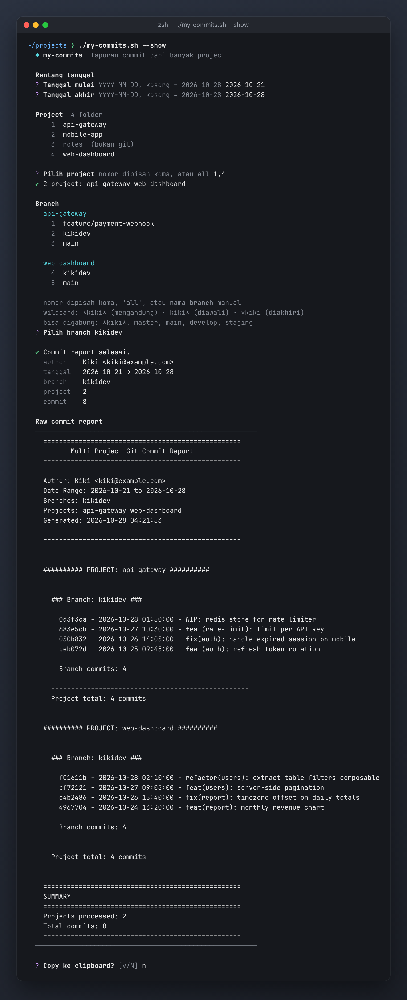
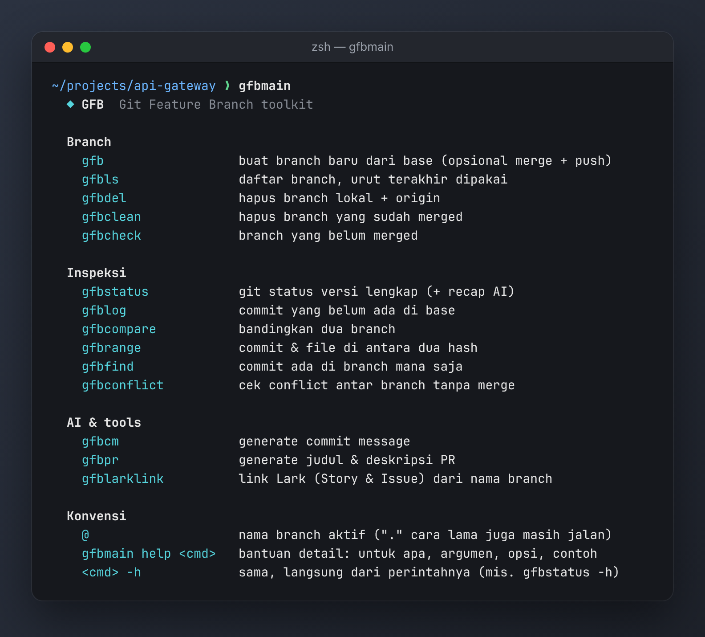
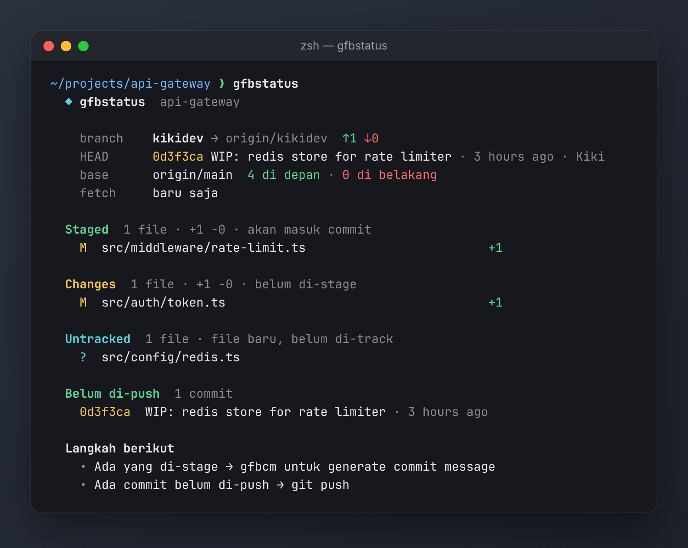
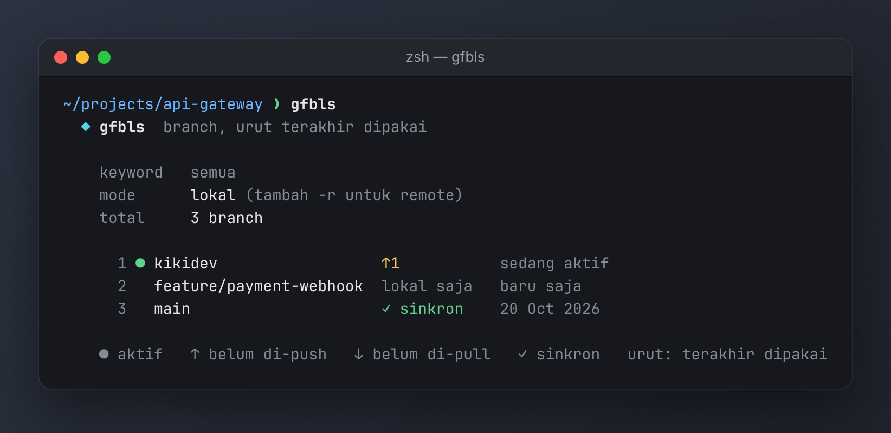
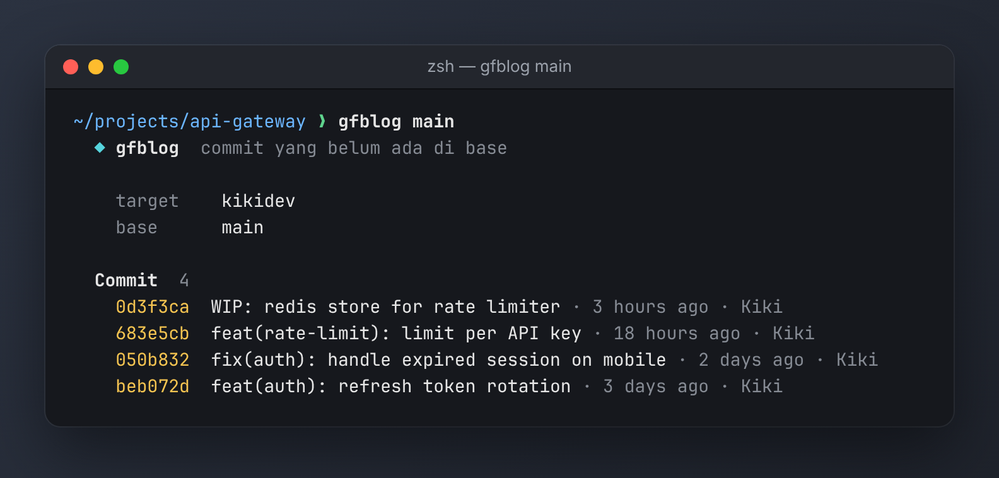
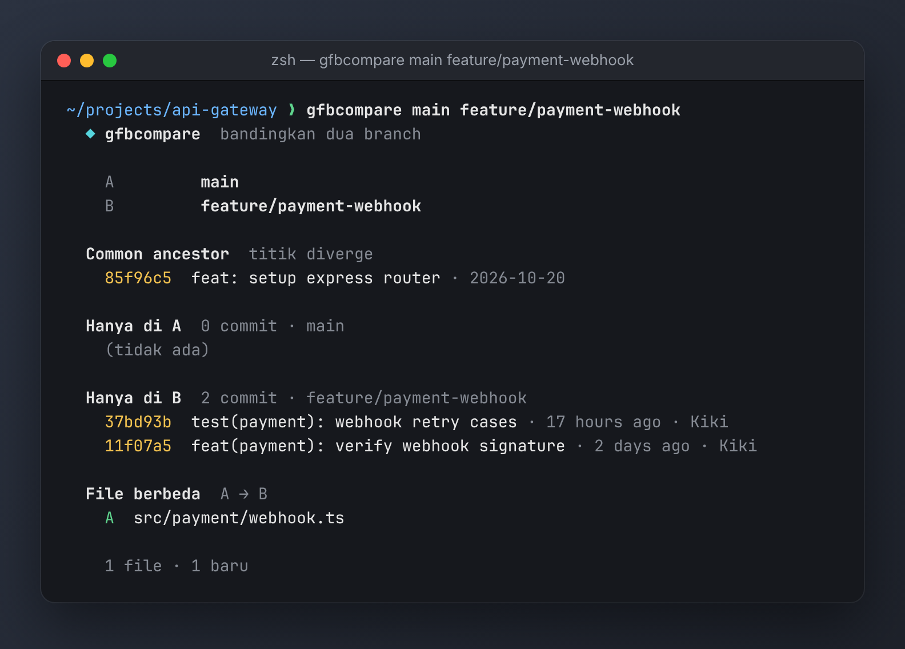

# Reusable Bash Command

Kumpulan script Bash yang dapat digunakan ulang untuk kebutuhan scripting dan otomasi proyek, seperti analisis struktur direktori, pengelolaan file, logging, dan lainnya.

Dibuat oleh [@kikiraihan](https://github.com/kikiraihan)

---

## generate_project_structure.sh

Script untuk menghasilkan:

- Struktur direktori proyek (mirip `tree`, tapi tanpa dependensi eksternal)
- Berguna untuk memberikan konteks kepada AI LLM ketika ingin memberi perintah
- Daftar semua file dalam format JSON
- Mendukung pengecualian folder yang tidak ingin disertakan

### Cara Pakai

```bash
./generate_project_structure.sh [folder_yang_ingin_diabaikan...]
````

Contoh:

```bash
./generate_project_structure.sh .git node_modules target build
```

### Output

* `struktur_folder_project.txt`
  Struktur direktori dengan indentasi seperti:

  ```
  ├── config/
      ├── SecurityConfig.java
  ├── controller/
      ├── ProductController.java
  ```

* `list_file_project.json`
  JSON array dari semua path file:

  ```json
  [
    "config/SecurityConfig.java",
    "controller/ProductController.java"
  ]
  ```

---

## my-commits.sh

Laporan commit milik sendiri dari banyak project sekaligus: pilih rentang tanggal, project, dan branch
(bisa wildcard seperti `*kiki*`). Report bisa tampil di terminal, disimpan ke file, atau dirangkum AI
jadi daily standup / weekly report. Detail lengkap ada di [`my-commit-readme.txt`](my-commit-readme.txt).

```bash
./my-commits.sh --show
```



---

## git-featuring-branch (gfb)

Kumpulan fungsi zsh untuk alur kerja feature branch. Pasang dengan `source` dari `~/.zshrc`:

```bash
source /path/to/reusable-bash-command/git-featuring-branch
```

Ketik `gfbmain` untuk daftar semua perintah, atau `gfbmain help <cmd>` / `<cmd> -h` untuk bantuan detail.

### Contoh penggunaan

**`gfbmain`** — ringkasan semua perintah



**`gfbstatus`** — git status versi lengkap: upstream, posisi terhadap base, staged/changes/untracked, commit belum di-push, dan langkah berikut



**`gfbls`** — daftar branch, urut terakhir dipakai, dengan status sinkron ke origin



**`gfblog main`** — commit di branch aktif yang belum ada di base



**`gfbcompare main feature/payment-webhook`** — bandingkan dua branch: common ancestor, commit yang hanya ada di masing-masing, dan file yang berbeda



> Screenshot diambil dari repo demo (`api-gateway`, `web-dashboard`, `mobile-app`) dengan data commit contoh.

---

## Others

Script lain akan ditambahkan di sini bila tersedia.
