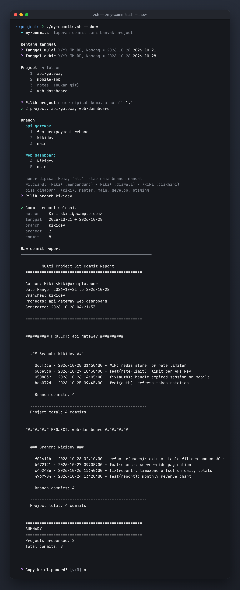
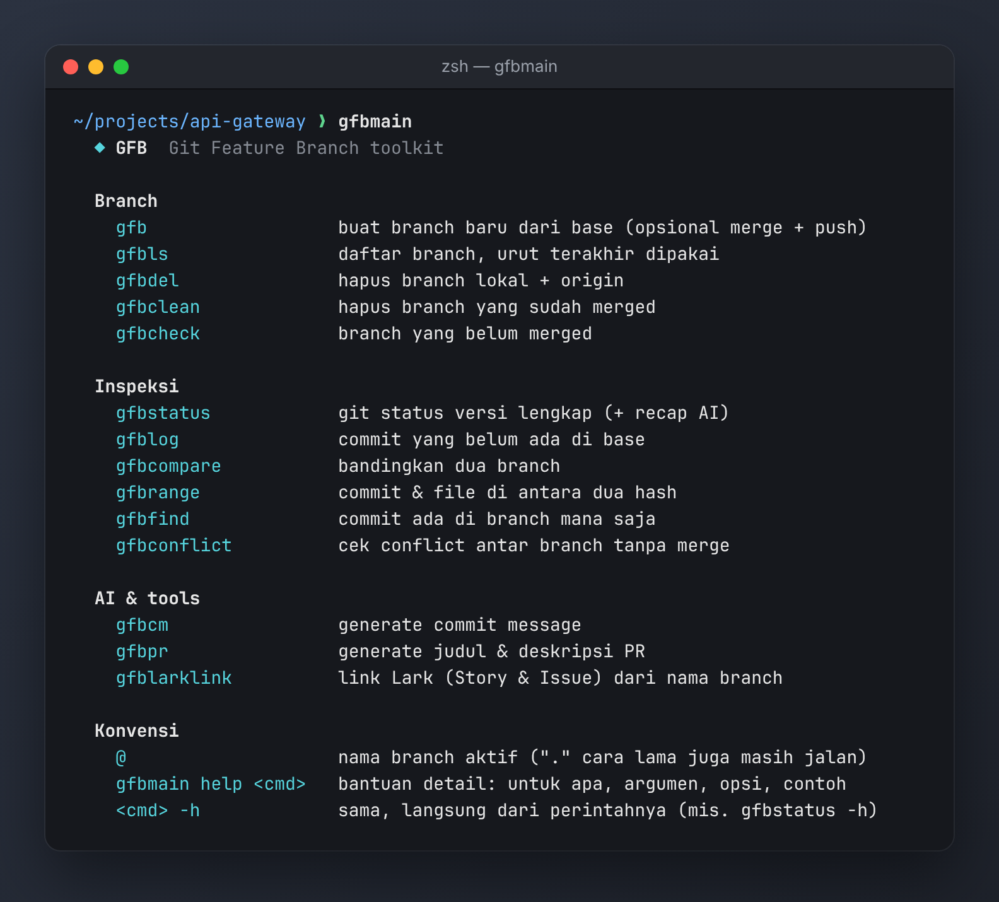
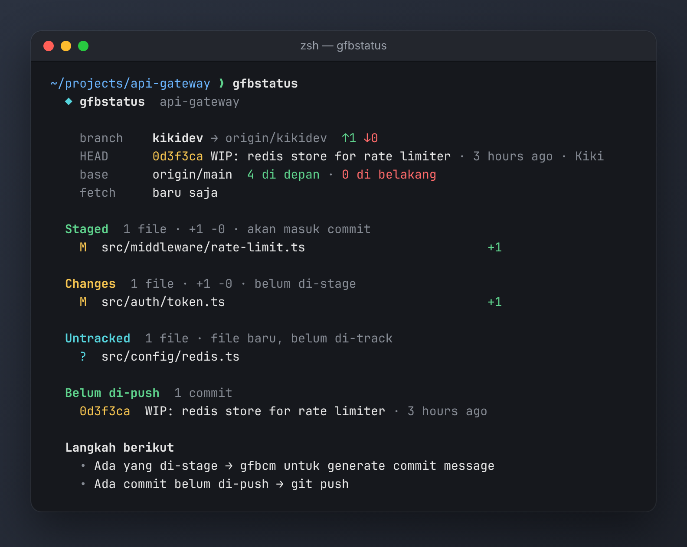
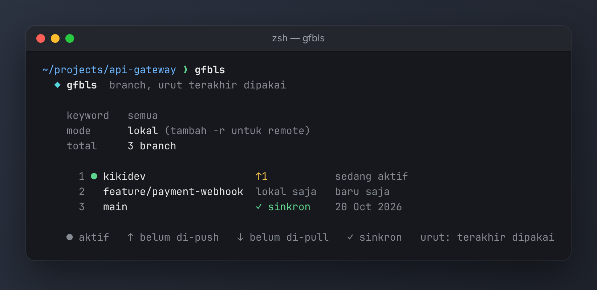
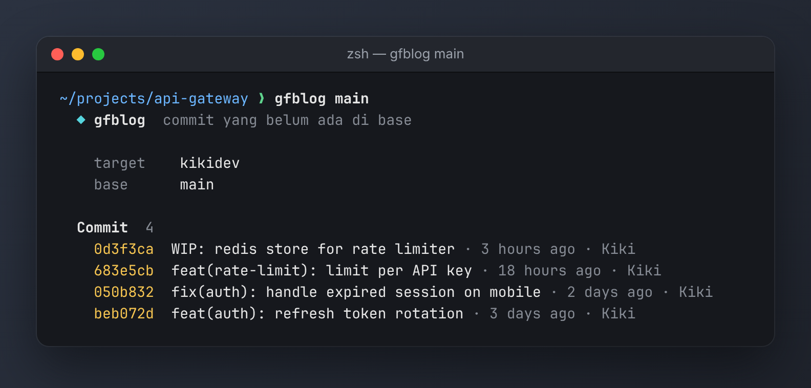
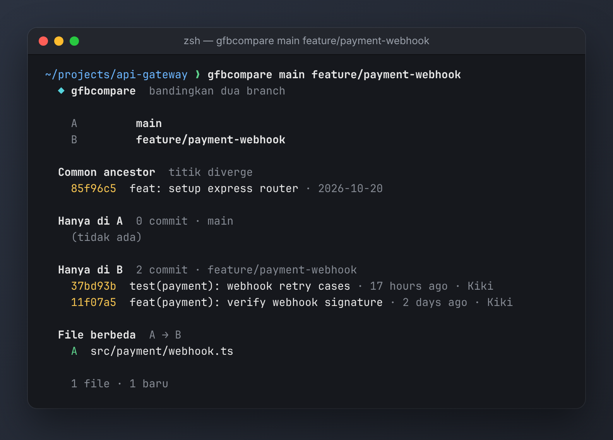

# Reusable Bash Command

Kumpulan script Bash yang dapat digunakan ulang untuk kebutuhan scripting dan otomasi proyek, seperti analisis struktur direktori, pengelolaan file, logging, dan lainnya.

Dibuat oleh [@kikiraihan](https://github.com/kikiraihan)

---

## generate_project_structure.sh

Script untuk menghasilkan:

- Struktur direktori proyek (mirip `tree`, tapi tanpa dependensi eksternal)
- Berguna untuk memberikan konteks kepada AI LLM ketika ingin memberi perintah
- Daftar semua file dalam format JSON
- Mendukung pengecualian folder yang tidak ingin disertakan

### Cara Pakai

```bash
./generate_project_structure.sh [folder_yang_ingin_diabaikan...]
````

Contoh:

```bash
./generate_project_structure.sh .git node_modules target build
```

### Output

* `struktur_folder_project.txt`
  Struktur direktori dengan indentasi seperti:

  ```
  ├── config/
      ├── SecurityConfig.java
  ├── controller/
      ├── ProductController.java
  ```

* `list_file_project.json`
  JSON array dari semua path file:

  ```json
  [
    "config/SecurityConfig.java",
    "controller/ProductController.java"
  ]
  ```

---

## my-commits.sh

Laporan commit milik sendiri dari banyak project sekaligus: pilih rentang tanggal, project, dan branch
(bisa wildcard seperti `*kiki*`). Report bisa tampil di terminal, disimpan ke file, atau dirangkum AI
jadi daily standup / weekly report. Detail lengkap ada di [`my-commit-readme.txt`](my-commit-readme.txt).

```bash
./my-commits.sh --show
```



---

## git-featuring-branch (gfb)

Kumpulan fungsi zsh untuk alur kerja feature branch. Pasang dengan `source` dari `~/.zshrc`:

```bash
source /path/to/reusable-bash-command/git-featuring-branch
```

Ketik `gfbmain` untuk daftar semua perintah, atau `gfbmain help <cmd>` / `<cmd> -h` untuk bantuan detail.

### Contoh penggunaan

**`gfbmain`** — ringkasan semua perintah



**`gfbstatus`** — git status versi lengkap: upstream, posisi terhadap base, staged/changes/untracked, commit belum di-push, dan langkah berikut



**`gfbls`** — daftar branch, urut terakhir dipakai, dengan status sinkron ke origin



**`gfblog main`** — commit di branch aktif yang belum ada di base



**`gfbcompare main feature/payment-webhook`** — bandingkan dua branch: common ancestor, commit yang hanya ada di masing-masing, dan file yang berbeda



**`gfbrenew`** — perbarui branch aktif dengan master terbaru, tanpa risiko kehilangan kerjaan

```bash
gfbrenew              # split-payment → backup split-payment-old-20261111, buat ulang dari origin/master, merge backup
gfbrenew -b develop   # pakai develop sebagai base
gfbrenew kiki/feat/SP-829   # branch lain, tanpa checkout (merge di memori; dibatalkan kalau akan conflict)
gfbrenew -dp          # hapus backup di akhir tanpa tanya + push (fast-forward, tanpa force)
gfbrenew -k           # simpan backup tanpa tanya
gfbrenew -n           # dry-run, lihat rencana saja
```

- Nama backup `<branch>-old-YYYYMMDD`; kalau tanggal sama sudah ada → `-2`, `-3`, dst. Backup hanya lokal.
- Backup dihapus paling akhir: tanpa `-d`/`-k` ditanya dulu (default: tidak dihapus).
- Tanpa argumen / `@` / `.` = branch aktif. Branch lain diperbarui tanpa checkout, jadi uncommitted changes di branch aktif aman; branch yang terbuka di worktree lain harus dijalankan dari worktree itu.
- Base diambil dari `origin/<base>` tanpa checkout, jadi aman dipakai di worktree. Upstream branch dipertahankan.
- Kalau conflict: proses berhenti, backup tetap aman, dan ditampilkan perintah untuk batal & kembali seperti semula.

**`gfblarkbranch`** — kebalikan `gfblarklink`: dari link/ID ticket Lark → branch terkait

```bash
gfblarkbranch https://project.larksuite.com/spd/issue/detail/24947357
gfblarkbranch 24805879       # ID saja
gfblarkbranch -c 24805879    # + branch yang memuat commit ber-ID ini (mis. develop / sprint)
gfblarkbranch -r 24805879    # repo ini saja, walau di dalam workspace
gfblarkbranch -x 24805879    # tanpa fetch origin
```

- Menampilkan branch yang namanya memuat ID (dicocokkan utuh), lokal/origin, kapan terakhir commit,
  status merged ke base, dan worktree kalau sedang terbuka. Bisa copy nama branch ke clipboard.
- Di dalam workspace multi-repo (`.gfbwt-ws`), semua repo dicari sekaligus (fetch paralel).

**`gfbwt`** — kelola git worktree: 1 branch = 1 folder, kerjakan beberapa branch sekaligus tanpa stash/checkout

```bash
gfbwt                                 # daftar worktree: status file, sinkron origin, commit terakhir
gfbwt add kiki/feat/SP-900 develop    # worktree branch baru dari origin/develop, lalu cd ke sana
gfbwt add kiki/feat/SP-829            # branch yang sudah ada (lokal/origin)
gfbwt go 829                          # cd ke worktree yang cocok
gfbwt main                            # kembali ke repo utama
gfbwt rm -b @                         # hapus worktree ini + branch-nya (lokal + origin)
gfbwt clean develop -b                # prune worktree hilang + hapus yang sudah merged
gfb -pw develop kiki/feat/SP-901      # gfb versi worktree: repo utama tidak di-checkout
```

- Lokasi: `../<repo>.wt/<branch-slug>` (ubah dengan `GFB_WT_DIR`).
  Kalau folder induk repo punya `.gfbwt-ws`, lokasinya jadi `<induk>/.wt/<branch-slug>/<repo>` (lihat workspace multi-repo di bawah).
- Setelah `add`: `.env*` yang di-gitignore di-copy dari repo utama, `vendor/` & `node_modules/`
  di-clone dengan APFS copy-on-write (`-i` untuk `composer install`/`npm ci`, `-x` tanpa deps),
  lalu `.gfbwt-setup` dijalankan kalau ada.
- `vendor/` sengaja tidak di-symlink: `__DIR__` PHP mengikuti symlink, sehingga autoload Composer
  akan memuat kode dari repo utama, bukan dari worktree.
- Terintegrasi: `gfbls` menandai branch di worktree lain dengan `⎇`, `gfbdel`/`gfbclean` tidak
  mencoba menghapus branch yang masih terbuka di worktree.

**`gfbwt ws`** — workspace multi-repo: 1 branch = 1 folder berisi beberapa repo yang sejajar.
Cocok kalau satu fitur menyentuh beberapa repo (mis. backend + admin panel) dalam satu folder induk.

```
projects/                     ← folder induk, berisi .gfbwt-ws
├── api-gateway/              ← repo utama (tetap)
├── web-dashboard/            ← repo utama (tetap)
└── .wt/
    └── kiki-feat-SP-900/     ← 1 workspace = 1 branch
        ├── api-gateway/      ← worktree
        └── web-dashboard/    ← worktree, branch sama, sejajar
```

```bash
# projects/.gfbwt-ws — per baris: <alias> <folder-repo> [base-default]
api   api-gateway     develop
web   web-dashboard   develop
```

```bash
gfbwt ws                                   # daftar workspace + status tiap repo + worktree di lokasi lama
gfbwt ws add kiki/feat/SP-900 api web      # worktree kedua repo sekaligus (semua dicek dulu)
gfbwt ws add @ web                         # lagi kerja di api, tambah web di sebelahnya (branch sama)
gfbwt ws add kiki/feat/SP-900 web:master   # base khusus untuk repo itu
gfbwt ws go web                            # dari dalam workspace → pindah ke repo web
gfbwt ws rm -b @                           # hapus workspace ini + branch-nya di semua repo
gfbwt ws migrate                           # pindahkan worktree lama <repo>.wt/... ke .wt/<branch>/<repo>
```

- Dengan `.gfbwt-ws`, `gfbwt add` / `gfb -w` biasa juga menaruh worktree di `.wt/<branch>/<repo>`,
  jadi hanya ada satu aturan lokasi dan repo lain dengan branch yang sama selalu ada di folder sebelah.
- Tanpa symlink: `../web-dashboard` dari dalam worktree tetap mengarah ke pasangannya, grep/IDE aman.
- Branch yang sudah punya worktree di lokasi lama → `ws add` menawarkan pindah (`git worktree move`,
  perubahan yang belum di-commit ikut pindah).

> Screenshot diambil dari repo demo (`api-gateway`, `web-dashboard`, `mobile-app`) dengan data commit contoh.

**`gfbwt ws serve`** — repo utama ikut branch workspace, untuk testing di server lokal (Valet, nginx, Herd, dll.)
yang menunjuk ke folder repo utama. Domain dan konfigurasi server tidak perlu diubah.

```bash
gfbwt ws serve                    # status: tiap repo utama sedang di branch apa + cek .env
                                  #   (di dalam workspace → langsung ditawari pindah)
gfbwt ws serve @                  # semua repo utama yang ada di workspace ini ← branch ini
gfbwt ws serve @ api              # hanya repo api
gfbwt ws serve web                # dari dalam workspace: sama dengan "@ web"
gfbwt ws serve SP-900             # dari mana saja di workspace: pilih workspace dengan keyword
gfbwt ws serve -n @               # dry-run, tampilkan rencana saja
gfbwt ws serve -y @               # tanpa konfirmasi (stash, composer install, salin .env otomatis)
gfbwt ws serve reset              # repo utama kembali ke branch asal sebelum serve
gfbwt ws serve reset -b           # kembali ke base (.gfbwt-ws / origin/HEAD), bukan branch asal
gfbwt ws serve reset all -bp      # semua repo utama ke base + git pull --ff-only
```

Contoh alur (workspace `kiki-feat-SP-900` berisi `api-gateway` (alias `api`) + `web-dashboard` (alias `web`),
`api.test` dan `admin.test` di-`valet link` ke repo utama):

```bash
cd .wt/kiki-feat-SP-900/web-dashboard  # bebas dari repo mana pun di workspace
gfbwt ws serve
#   Repo utama
#     api    ⎇ develop
#     web    ⎇ master   ✎ 2 file
#   Workspace ini
#     api    kiki/feat/SP-900 @a1b2c3d
#            ▲ 1 key ada di .env worktree, belum di .env utama: PAYMENT_SPLIT_URL
#            ≠ 1 key beda nilai dengan worktree: DB_DATABASE
#     web    kiki/feat/SP-900 @9f8e7d6
#            ▲ 3 file belum di-commit di worktree — tidak ikut (commit, lalu serve lagi)
#            ✓ .env sinkron
#   ? Pindahkan repo utama (api, web) ke branch ini? [y/N] y
#   ✔ api develop → kiki/feat/SP-900 @a1b2c3d
#   ℹ api: 2 migration baru  → cd ~/…/api-gateway && php artisan migrate
#   ? Salin 1 key dari .env worktree ke .env utama api? [Y/n]
#   › web: 2 file di-stash (gfbwt-serve: master)
#   ✔ web  master → kiki/feat/SP-900 @9f8e7d6

# test di https://api.test & https://admin.test …
# commit baru di worktree? status menampilkan "↻ N commit baru", jalankan lagi:
gfbwt ws serve -y @

# selesai: rollback migration fitur dulu (diingatkan otomatis), lalu kembalikan
gfbwt ws serve reset              # api → develop, web → master + stash dikembalikan
```

- Git melarang satu branch terbuka di dua worktree, jadi repo utama di-checkout **detached** ke commit
  branch itu. Hanya yang sudah di-commit yang ikut; commit baru → jalankan `serve` lagi.
- Repo utama kotor → di-stash dulu, lalu dikembalikan (`stash pop`) saat `reset`.
- Cek `.env`: key yang ada di `.env` worktree tapi belum di `.env` utama (ditawari salin),
  key `.env.example` (versi branch) yang belum di-set di mana pun, key yang nilainya beda.
- `composer.lock` / `package-lock.json` berubah → ditawari `composer install` / `npm ci`.
  Migration baru → diingatkan `migrate`; saat `reset` diingatkan `migrate:rollback --step=N` dulu.
- Laravel: `php artisan optimize:clear` otomatis setelah pindah.
- `gfbwt ws rm` workspace yang sedang di-serve → repo utama otomatis di-reset dulu.
- `gfbwt ws` menandai workspace yang sedang dipakai repo utama dengan `◉ serve: api, web`.
- State tersimpan di `<induk>/.wt/.gfbwt-serve`.

**`gfbwt ws config`** — rawat `.gfbwt-ws`: file ini hanya dibaca oleh perintah lain, jadi lama-lama bisa usang

```bash
gfbwt ws config        # cek base usang/kosong + repo yang punya worktree di .wt tapi belum terdaftar
gfbwt ws config -n     # dry-run
gfbwt ws config -a     # + tawarkan semua repo git di folder induk
gfbwt ws config -y     # terapkan tanpa tanya (alias pakai usulan)
```

```
    alias    repo            base      aktif     status
    api      api-gateway     develop   master    ▲ usang (develop terakhir 203 hari lalu, master 20 jam lalu)
    web      web-dashboard   develop   develop   ✓
    biller?  biller-service  -         master    ＋ belum terdaftar, punya 1 worktree
  ? Terapkan 2 perubahan ke .gfbwt-ws? [Y/n]
```

- **Base aktif** = `master`/`main`/`develop` yang commit terakhirnya paling baru (origin, lalu lokal).
  `origin/HEAD` sengaja tidak dipakai karena sering tertinggal (masih `develop` padahal tim sudah pindah ke `master`).
- **Usang** = base tertulis tertinggal lebih dari 30 hari dari base aktif (ubah dengan `GFBWT_STALE_DAYS`).
- Komentar dan urutan baris di `.gfbwt-ws` dipertahankan.
- `gfbwt add` / `gfb -w` untuk repo yang belum terdaftar (tapi folder induknya workspace) langsung menawarkan
  pendaftaran: `? Daftarkan sebagai alias? (Enter = biller, base master; - = tidak)`.
- `gfbwt ws` menampilkan `config ▲ …  → gfbwt ws config` kalau ada yang perlu dirawat.

**`gfbrepos`** — dari folder induk, lihat branch aktif semua repo di bawahnya sekaligus

```bash
cd ~/projects        # folder induk berisi banyak repo
gfbrepos             # semua repo (anak langsung): branch, status file, sinkron origin, commit terakhir
gfbrepos payment     # filter nama folder / branch
gfbrepos -w          # + semua worktree (.wt/<branch>/<repo>, <repo>.wt/<branch>)
gfbrepos -d 2        # cari sampai 2 level folder
```

```
  ◆ gfbrepos  5 repo di ~/projects

    api-gateway     ◉ kiki/feat/SP-900   ✓ bersih   -          2 hours ago    ⎇2
    web-dashboard   ◉ kiki/feat/SP-900   ✓ bersih   -          3 hours ago    ⎇1
    mobile-app      develop              ✓ bersih   sinkron    6 months ago
    docs-site       kiki/feat/SP-1257    ✎ 3 file   sinkron    7 months ago
    legacy-service  master               ✓ bersih   ↓50        6 months ago
```

- Hijau = branch utama (`master/main/develop/...`), `◉` = repo utama sedang `gfbwt ws serve`,
  `⎇N` = punya N worktree.

---

## Others

Script lain akan ditambahkan di sini bila tersedia.
